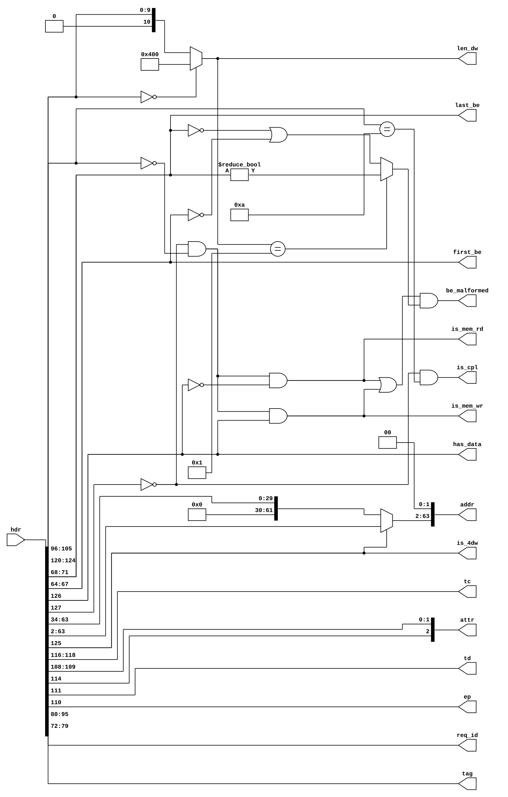
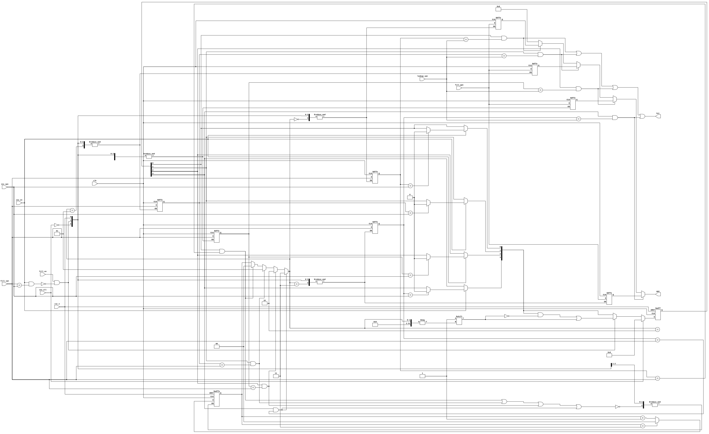
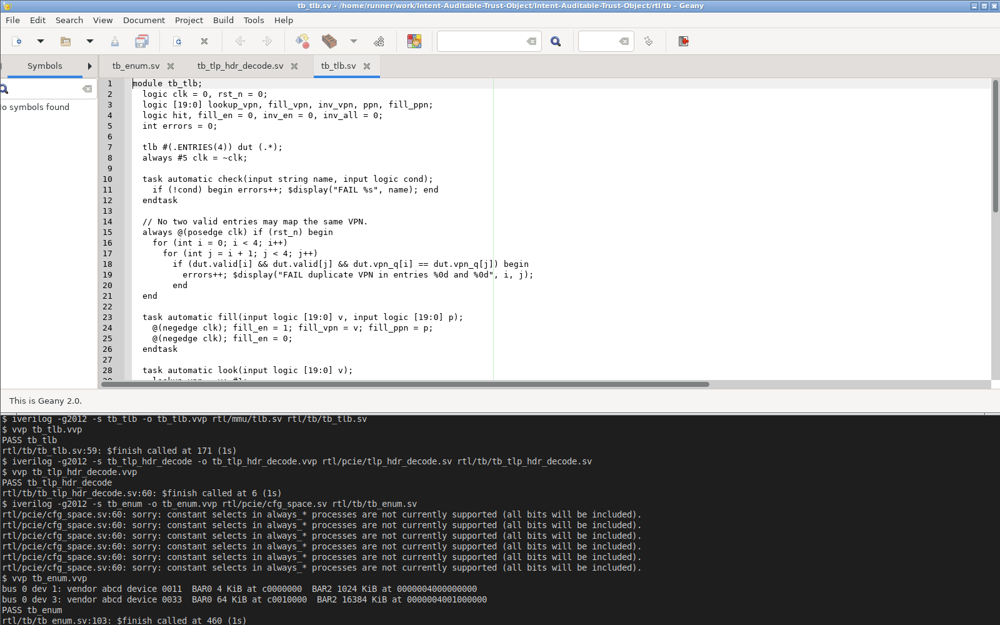
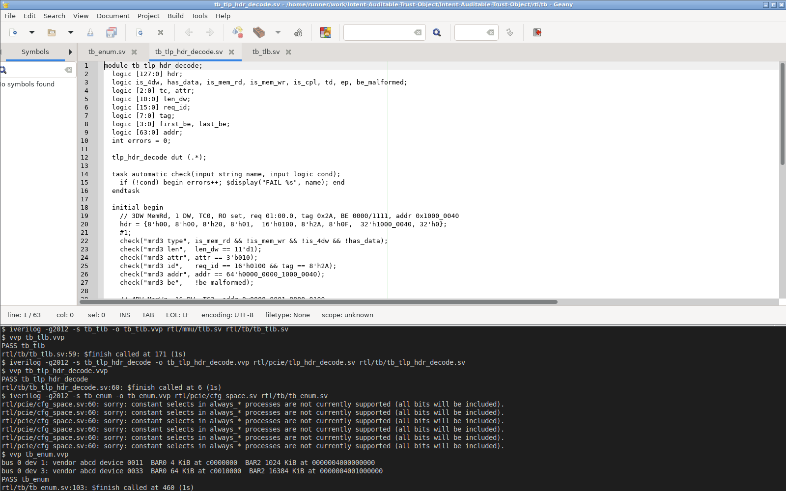
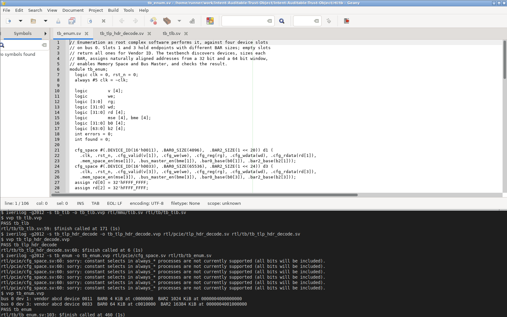
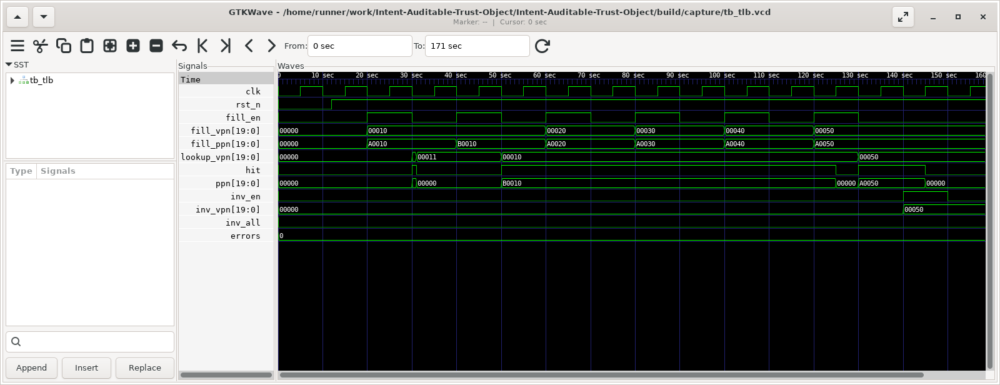

# IATO

IATO (Intent to Auditable Trust Object) is the monolith of the IATO series: a single repository in which hardware behaviour below the operating system is written down as machine-checkable specifications, then built, simulated, synthesised and measured. It covers cache coherence, CHI home node serialisation, TLB shootdown, PCIe posted-write ordering and enumeration, a DMA engine with its C driver, and memory-model litmus tests on Arm silicon. It is not a production device, driver or IP core: all results come from model checking, simulation, open tool synthesis and one silicon litmus run, with no physical FPGA and no vendor tools. Every number in this document comes from a run of `./scripts/check.sh` or the bench scripts at tag v0.2.0, and CI repeats the checks on every push and pull request.

The key words MUST, MUST NOT, SHALL, SHOULD and MAY in this document are to be interpreted as described in BCP 14 (RFC 2119 and RFC 8174).

## Scope

In scope:

- CHI coherence: RN-F states I, UC, UD, SC and SD with an HN-F that serialises ReadShared, ReadUnique and WriteBackFull, one snoop per step (`spec/chi/CHIHome.tla`).
- Atomic bus MESI and MOESI baselines (`spec/coherence/MESI.tla`, `spec/coherence/MOESI.tla`).
- TLB shootdown: no core keeps a translation to a freed frame (`spec/tlb/TLBShootdown.tla`).
- PCIe posted-write ordering with and without Relaxed Ordering (`spec/pcie/TLPOrdering.tla`).
- PCIe enumeration: a Type 0 configuration header with a 32 bit BAR and a 64 bit prefetchable BAR pair (`rtl/pcie/cfg_space.sv`, `rtl/tb/tb_enum.sv`).
- PCIe TLP decode: 3DW and 4DW memory request and completion headers with byte enable checks (`rtl/pcie/tlp_hdr_decode.sv`).
- A descriptor ring DMA engine with OWN and DONE handoff, driven by a C driver under Verilator (`rtl/dma/dma_engine.sv`, `driver/dma_drv.c`).
- A fully associative TLB with fill, invalidate by VPN and invalidate all (`rtl/mmu/tlb.sv`).
- Memory models: 15 expected allow or forbid results under SC, TSO and a simplified relaxed model (`memory-models/litmus.py`).
- Sail: the TLBI by-VA operand layout from DDI0487K and the DMA descriptor OWN and DONE handoff, with 14 executable assertions (`spec/sail/`).
- Litmus tests on an Arm Neoverse V2 host (`memory-models/hw/litmus_hw.c`).

Out of scope:

- Physical FPGA measurement, vendor synthesis tools and ASIC figures.
- In `CHIHome.tla`: UCE, UDP, direct memory or cache transfer (DMT, DCT), retry with protocol credits, and CompAck timing.
- Fmax of the DMA engine with MAX_RD 32, which has not been measured.

Known limitations:

- Synthesis figures are open tool estimates on a small FPGA (Lattice LFE5U-25F, seed 1). They are not vendor tool or ASIC numbers.
- The CHI fairness result states what the arbiter has to guarantee, not how CHI implements it.
- The silicon litmus counts come from one run on 2026-11-14 and vary run to run. LB was not observed in that run; this is not proof that it cannot happen.
- The CI workflow runs on the GitHub `ubuntu-24.04` runner, so its hardware litmus step exercises the runner's CPU, not the Neoverse V2 host.
- `CHIHomeCredits` (FIFO credit grant, 16,500 states, progress under weak fairness) is in pull request 27 (`feat/chi-retry-credits`) and is not yet on main.

Planned work (not implemented):

1. CHI: transient states at the RN-F, DCT, and retry with credits instead of strong fairness.
2. DMA: descriptor prefetch, scatter gather, MSI on completion, and a Linux PCI driver skeleton using the same register map.
3. PCIe: completion ordering and a TLP generator wired to the DMA engine.
4. Formal: SystemVerilog assertions on the DMA handoff, checked with SymbiYosys.
5. Arm: Stage 2 translation and TLBI semantics from DDI0487K, cross checked against QEMU target/arm.

### System overview

How one copy moves through the pieces, and which specification covers each hop.

```
  software                         device (rtl/)                       checked by
 ----------                       ---------------                     ------------
 enumeration (tb_enum.sv)
   |  cfg read/write, BAR sizing
   v
 +----------------+   Type 0    +-------------------+                  tb_enum (sim)
 | host / driver  |-----------> | cfg_space.sv      |                  synth (Yosys)
 | dma_drv.c      |   header    | BAR0 regs, BAR2/3 |
 | (Linux: PR 28) |             +-------------------+
 +----------------+                      |
   | 1 write desc: src, dst, len         | BAR0 MMIO
   | 2 dma_wmb, set OWN                  v
   | 3 doorbell TAIL ------------> +-------------------+               Sail dma_desc
   |                               | dma_engine.sv     |               SVA (PR 26)
   |                               | fetch desc        |               bench (Verilator)
   |                               | copy, MAX_RD reads|
   |                               | writeback OWN=0,  |
   |                               | DONE=1, HEAD++    |
   |                               +-------------------+
   |                                  | 8 B beats, one port
   v                                  v
 +-----------------------------------------------------+
 | host memory: descriptor ring, source, destination   |              TLPOrdering.tla
 +-----------------------------------------------------+              tlp_hdr_decode.sv
   ^  4 reap: read DONE from memory, dma_rmb
   |
 +----------------+    coherence     +--------------------+           CHIHome.tla
 | CPU caches     |<---------------->| CHI home node HN-F |           MESI / MOESI.tla
 | RN-F I UC UD   |   snoops, data   | serialises requests|           litmus (Neoverse V2)
 | SC SD          |                  +--------------------+
 +----------------+
   | unmap, TLBI, IPI                                                 TLBShootdown.tla
   v                                                                  Sail aarch64_tlbi
 +----------------+                                                   tlb.sv (sim, synth)
 | TLB (tlb.sv)   |
 +----------------+
```

### DMA engine and driver

The engine walks a ring of 32 byte descriptors in host memory. The driver MUST write source, destination and length, set OWN last, issue a write barrier and then ring the TAIL doorbell. The engine fetches the descriptor, copies 8 bytes per beat, writes back OWN cleared and DONE set, and only then advances HEAD and DONE_CNT in the same cycle. The driver reaps by reading DONE from memory, so the fast path does not touch a register.

An early version updated DONE_CNT one cycle after writing DONE, and the driver could read a stale count. The fix is in the RTL, and the harness checks the count after every run.

### CHI mapping

| MOESI | CHI | Meaning |
|---|---|---|
| M | UD | Only copy, modified |
| E | UC | Only copy, clean |
| S | SC | Shared, not responsible for writeback |
| O | SD | Shared, responsible for writeback |
| I | I | No copy |

### Repository layout

```
spec/            TLA+: chi/, coherence/, tlb/, pcie/; Sail: sail/
rtl/pcie/        cfg_space.sv, tlp_hdr_decode.sv
rtl/dma/         dma_engine.sv
rtl/mmu/         tlb.sv
rtl/tb/          Icarus testbenches
driver/          dma_drv.c, dma_drv.h
bench/           Verilator harness, run.sh, synth.sh, vcd_view.py, results/, wave/
memory-models/   litmus.py (models), hw/litmus_hw.c (silicon)
scripts/check.sh everything, with expected passes and expected failures
docs/            references.md, RESULTS.md, screenshots/, capture/ (schematic and screenshot scripts)
```

## Requirements

- Java 11 or later (CI uses Temurin 21), for TLC.
- Python 3.
- Icarus Verilog and Verilator.
- A C compiler.
- Optional: Yosys and nextpnr-ecp5 for synthesis, and Sail 0.20 with libgmp for the Sail checks (CI uses Sail 0.20.3).
- Optional: Matplotlib, used only to render the waveform image.

CI installs these on `ubuntu-24.04`; see [.github/workflows/check.yml](.github/workflows/check.yml). Other platforms have not been tested.

## Build

No separate build step is required. `scripts/check.sh` and `bench/run.sh` compile the simulation models, the driver and the litmus program as they run. If `tools/tla2tools.jar` is absent, `scripts/check.sh` downloads TLA+ tools v1.8.0 into `tools/`.

## Usage

```
./scripts/check.sh    # every check, with expected passes and expected failures
bench/run.sh          # Verilator DMA sweep for MAX_RD 8 and 32, plus a VCD capture
bench/synth.sh        # Yosys synth_ecp5 and nextpnr-ecp5 out of context
```

`bench/run.sh` writes `bench/results/dma_maxrd8.csv`, `bench/results/dma_maxrd32.csv` and `bench/results/dma_two_descriptors.vcd`. If Matplotlib is installed, it also renders `bench/wave/dma_two_descriptors.png`, the simulated logic analyser view of two 64 byte descriptors at latency 4, using `bench/vcd_view.py`. `bench/synth.sh` writes `bench/results/synth_ecp5.csv`.

The silicon litmus program MAY be built and run on its own:

```
cc -O2 -pthread memory-models/hw/litmus_hw.c -o litmus_hw
./litmus_hw [iterations]
```

## Configuration

- `TLA_JAR`: path to `tla2tools.jar` used by `scripts/check.sh`. The default is `tools/tla2tools.jar`.
- `MAX_RD`: `dma_engine` parameter giving the number of outstanding reads. The default is 8; `bench/run.sh` builds and runs both 8 and 32.

## Verification and testing

`./scripts/check.sh` runs every check and exits non zero on any unexpected result. Passing specifications MUST pass, and each `_bug` or `_starve` configuration MUST fail. The Sail step runs only when `sail` is on the path, and the synthesis step only when `yosys` is on the path. The CI workflow runs the same script on every push and pull request. Full tables for every run are in [docs/RESULTS.md](docs/RESULTS.md).

### Results summary

| Area | Artefact | Result |
|---|---|---|
| CHI coherence | `spec/chi/CHIHome.tla` | SWMR, single dirty copy, data value and memory currency hold over 11,590 states (3 RN-F, 2 values). Request progress holds with a fair home arbiter; with weak fairness TLC finds a starving requester |
| Coherence | `spec/coherence/MESI.tla`, `MOESI.tla` | Atomic bus baselines, 120 and 216 states, all invariants hold |
| Virtual memory | `spec/tlb/TLBShootdown.tla` | No core keeps a translation to a freed frame; freeing before every IPI ack fails |
| PCIe ordering | `spec/pcie/TLPOrdering.tla` | Flag then data is safe with strict posted ordering; Relaxed Ordering on the flag write lets the consumer read stale data |
| PCIe enumeration | `rtl/pcie/cfg_space.sv`, `rtl/tb/tb_enum.sv` | The testbench scans bus 0, skips empty slots, sizes every BAR by writing all ones, assigns naturally aligned addresses and enables Memory Space and Bus Master |
| PCIe TLPs | `rtl/pcie/tlp_hdr_decode.sv` | 3DW and 4DW memory request and completion decode with byte enable checks |
| DMA | `rtl/dma/dma_engine.sv`, `driver/dma_drv.c` | Every copy in the sweep is verified byte for byte |
| MMU | `rtl/mmu/tlb.sv` | Fill, invalidate by VPN and invalidate all |
| Memory models | `memory-models/litmus.py` | 15 expected allow or forbid results under SC, TSO and a simplified relaxed model all hold |
| Sail | `spec/sail/` | Typechecked and compiled to C, 14 executable assertions pass |
| Silicon | `memory-models/hw/litmus_hw.c` | Litmus runs on a Neoverse V2 host; see below |

### RTL schematics and testbench captures

Every image in this section was produced by [`.github/workflows/captures.yml`](.github/workflows/captures.yml) on an `ubuntu-24.04` runner from the RTL in this repository: the schematics by Yosys and netlistsvg, the rest as screenshots of a real X display (Xvfb). Rerun the workflow to regenerate them. The design is digital throughout; it has no analog or mixed-signal blocks.

**Schematic, `tlp_hdr_decode`.** RTL-level netlist after Yosys `proc` and `opt`, before technology mapping: header bit fields fan out to the type, length, byte enable and address decode. [SVG](docs/screenshots/schematic_tlp_hdr_decode.svg)



**Schematic, `tlb` with `ENTRIES = 4`.** The four VPN and PPN registers, the parallel compare that drives `hit`, the round robin victim counter and the invalidate paths. [SVG](docs/screenshots/schematic_tlb.svg)



**Testbenches open in Geany, with Icarus Verilog 12.0 running them.** All three testbenches print `PASS`. The `sorry: constant selects` lines are Icarus warnings on `cfg_space.sv`; Verilator lints the same file clean in `scripts/check.sh`. The full log is in [docs/screenshots/sim.log](docs/screenshots/sim.log).







**`tb_tlb` waveform in GTKWave.** Fill, refill in place, a fifth fill that evicts the round robin victim, invalidate by VPN and invalidate all, with `errors` held at 0. The testbench sets no `timescale`, so GTKWave labels the simulator time steps in seconds.



### DMA benchmark

Source: `bench/run.sh`. The memory port takes one request per cycle and is shared between reads and writes, so the ceiling is 4 bytes per cycle. Reads can be outstanding up to `MAX_RD`. Values are bytes per cycle.

| Copy size | Latency 1 | Latency 8 | Latency 32, MAX_RD 8 | Latency 32, MAX_RD 32 |
|---|---|---|---|---|
| 64 B | 2.46 | 1.88 | 0.78 | 0.78 |
| 512 B | 3.71 | 3.35 | 1.39 | 2.99 |
| 4 KiB | 3.96 | 3.71 | 1.54 | 3.79 |
| 64 KiB | 4.00 | 3.76 | 1.56 | 3.93 |

At latency 32 with 8 reads in flight the engine is bound by Little's law: 8 beats of 8 bytes per round trip. With 32 in flight it reaches within 2 percent of the ceiling. Small copies are bound by the descriptor fetch and writeback, which is the case for batching or prefetching descriptors.

### Synthesis

Yosys `synth_ecp5`, then nextpnr place and route out of context (no IO buffers) on a Lattice LFE5U-25F, seed 1.

| Module | LUT4 | FF | Carry | Post route Fmax |
|---|---|---|---|---|
| dma_engine (MAX_RD 8) | 966 | 954 | 154 | 129.10 MHz |
| tlb (4 entries) | 912 | 166 | 0 | 115.47 MHz |
| cfg_space | 138 | 75 | 0 | no register to register path |
| tlp_hdr_decode | 74 | 0 | 0 | combinational |

At 129.10 MHz the DMA ceiling of 4 bytes per cycle is about 516 MB/s.

### Litmus tests on silicon

`memory-models/hw/litmus_hw.c` runs each test 2,000,000 times on two threads with plain LDR and STR, DMB ISH, or LDAR and STLR. Host: Arm Neoverse V2 (MIDR part 0xd4f), Linux, run 2026-11-14.

| Test | Relaxed outcome | Seen |
|---|---|---|
| SB | r0=0, r1=0 | 10,576 |
| SB+dmb | r0=0, r1=0 | 0 |
| MP | r0=1, r1=0 | 181 |
| MP+dmb | r0=1, r1=0 | 0 |
| MP+stlr+ldar | r0=1, r1=0 | 0 |
| LB | r0=1, r1=1 | 0 |

MP reordering was observed on this host, and both fixes removed it in this run. LB is allowed by the architecture and was not observed, which is usual on current cores. CI asserts only that fenced variants never show the relaxed outcome.

## Security

Commit verification and vulnerability reporting are described in [SECURITY.md](SECURITY.md); the maintainer signing key is in [KEYS.asc](KEYS.asc).

## License

Apache License 2.0. See [LICENSE](LICENSE).
